# ELEC4-Python-Zaratan

## Student Information

- **Name:** RJ Joshua C. Zaratan
- **Section:** IV-BSIT B
- **Course:** ELEC 4 – Python Programming

---

## Set 1 – Python Programming Activities

### [P1 – Student Grade Calculator](set1/p1/)

A menu-driven program that calculates students' average, highest grade, lowest grade, and pass/fail status using functions.

**How to Run:**

```bash
python set1/p1/p1_grade_calculator.py
```

**Screenshot:**

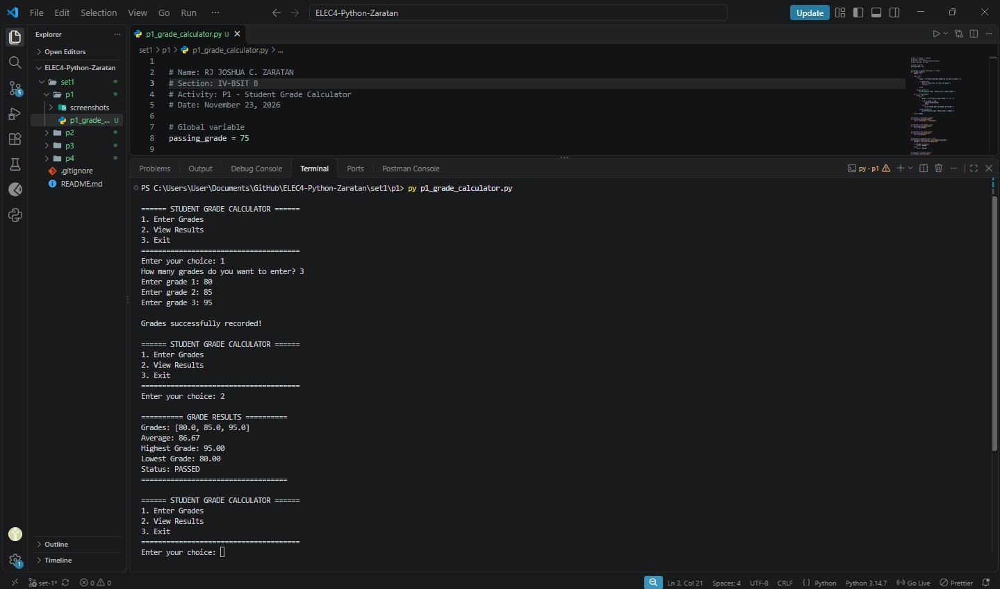

---

### [P2 – Custom Module](set1/p2/)

A program that uses a custom Python module containing functions for calculating average, pass/fail status, highest grade, and lowest grade. It also demonstrates the use of Python built-in modules.

**How to Run:**

```bash
python set1/p2/p2_main.py
```

**Screenshot:**

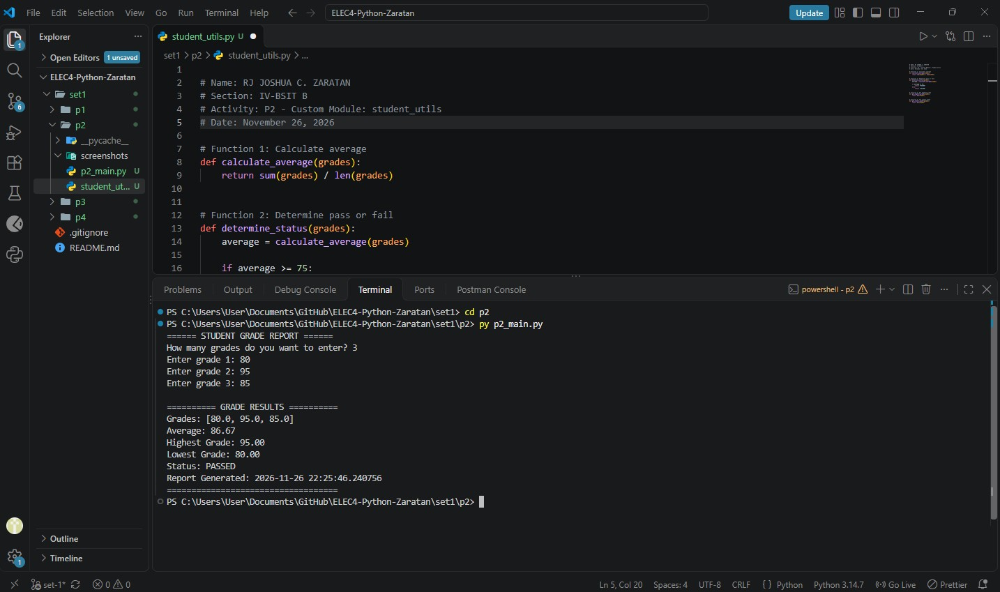

---

### [P3 – Student Record Manager](set1/p3/)

A menu-driven program that allows users to add, remove, search, and display student records. It prevents duplicate entries and supports case-insensitive searching.

**How to Run:**

```bash
python set1/p3/p3_record_manager.py
```

**Screenshots:**

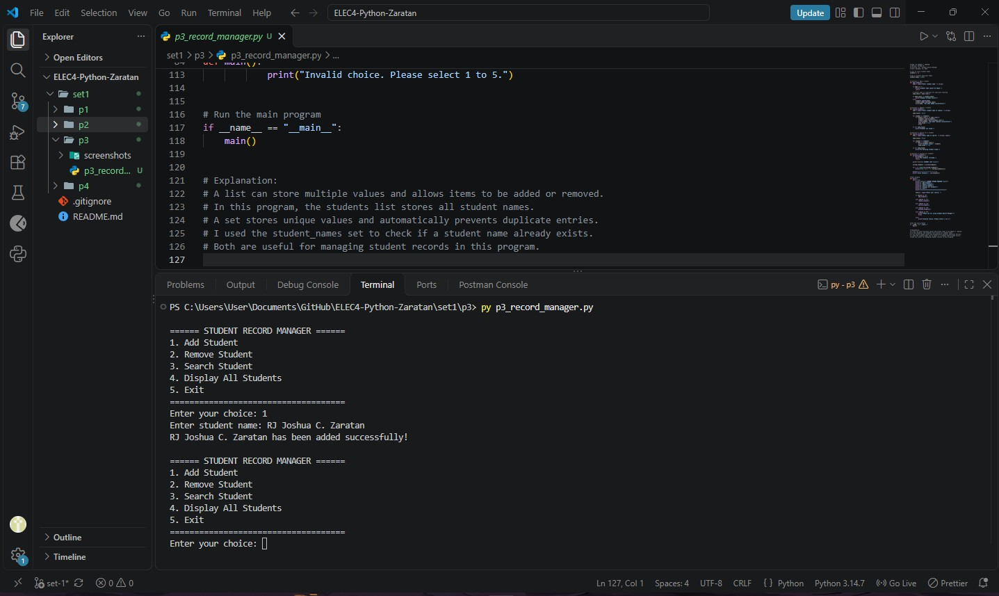

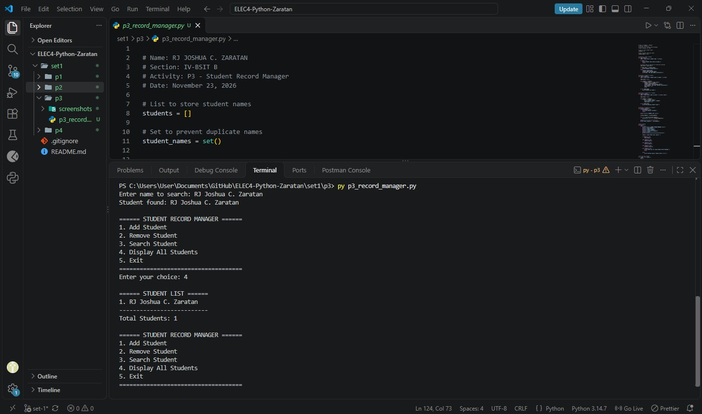

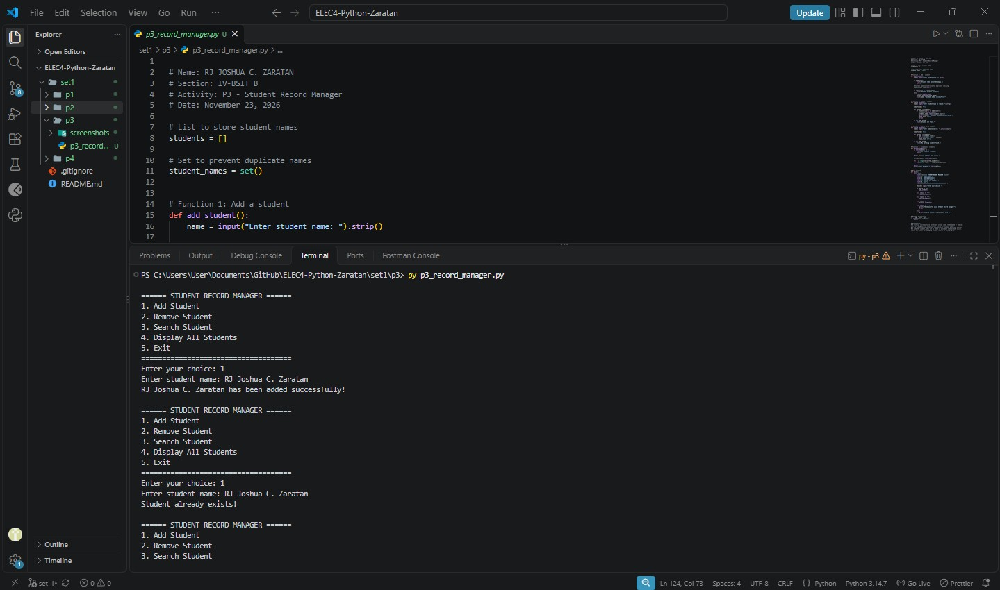

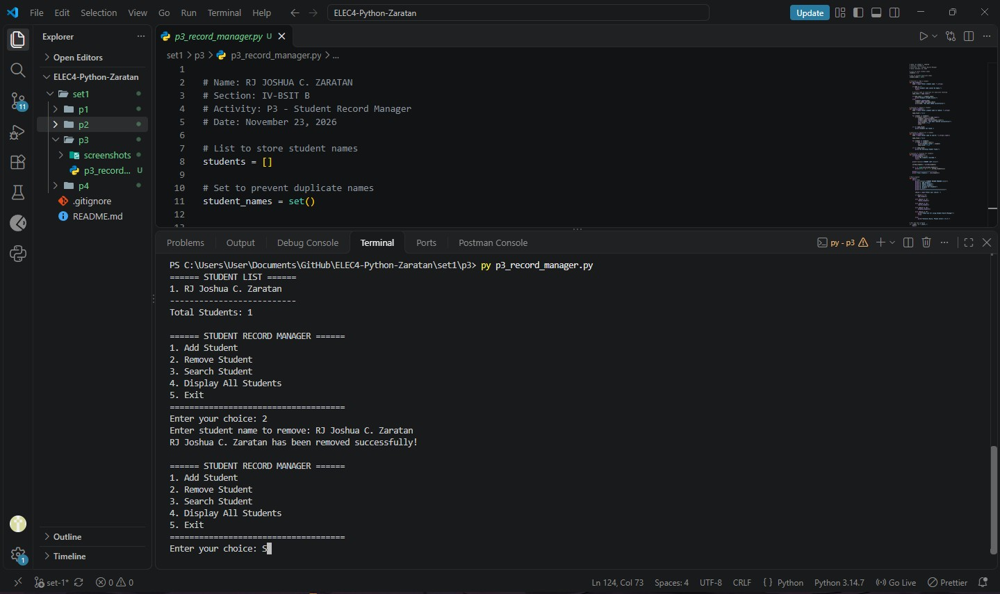

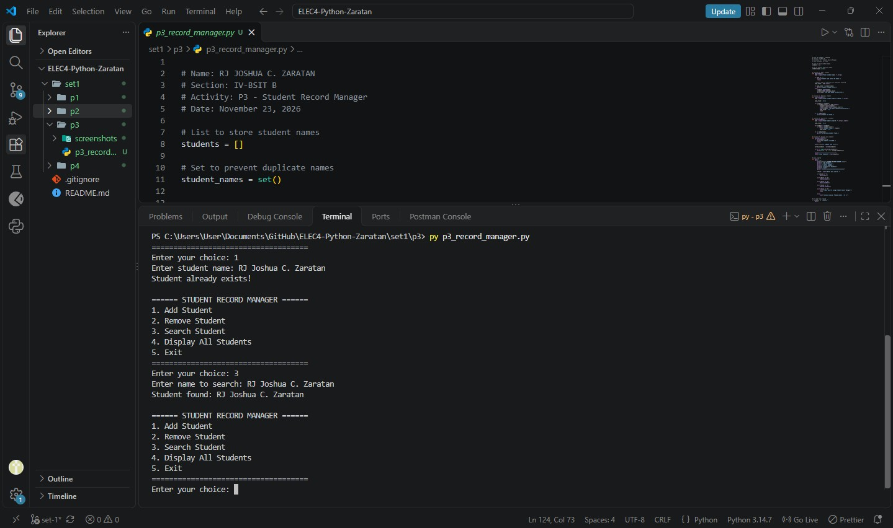

---

### [P4 – Safe Menu Program](set1/p4/)

A menu-driven program that demonstrates exception handling using `try`, `except`, `else`, and `finally`. It handles invalid inputs, division errors, and missing files.

**How to Run:**

```bash
python set1/p4/p4_exceptions.py
```

**Screenshots:**

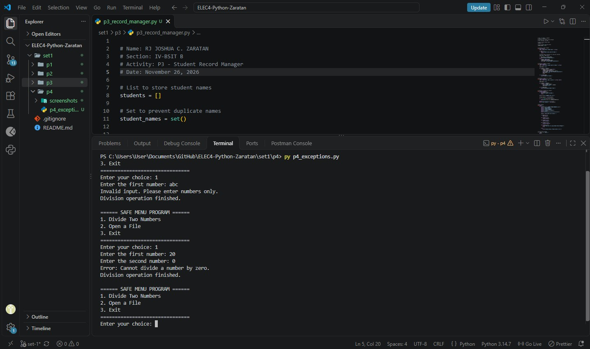

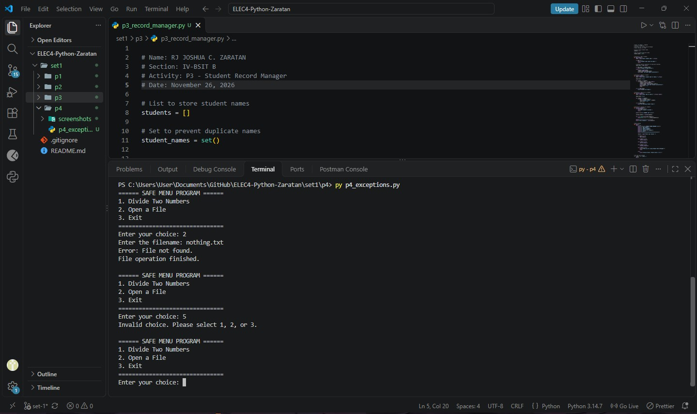

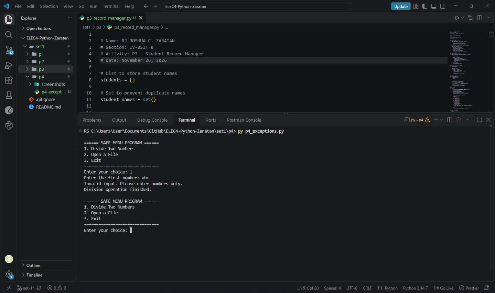

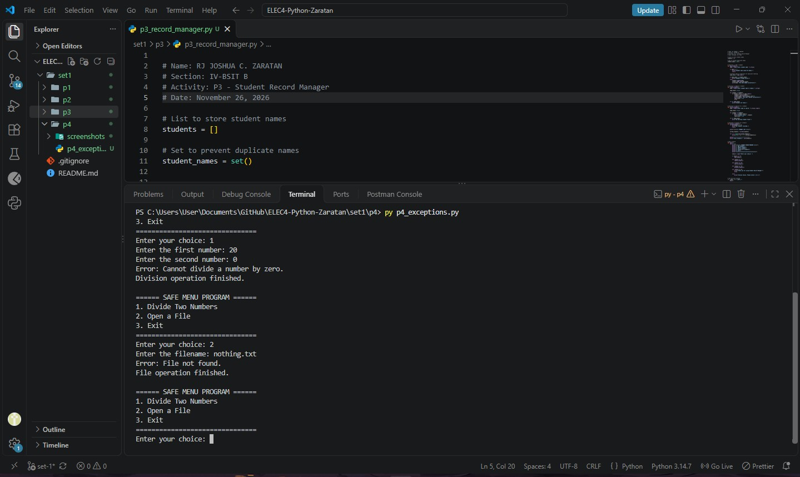

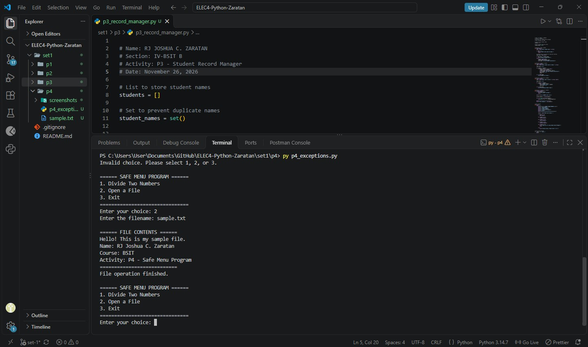

---

*More activities will be added when Set 2 is completed.*